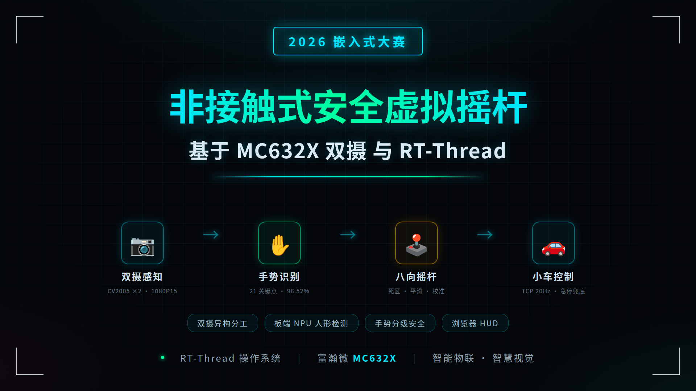
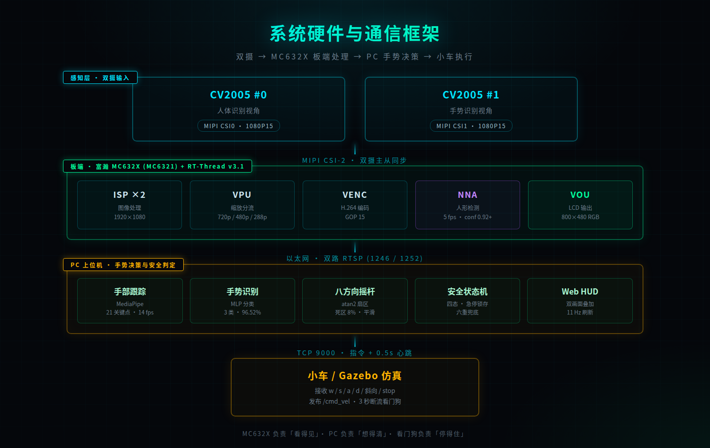

# 安全虚拟摇杆 · MC632X 双摄非接触式遥控

基于富瀚 MC632X 与 RT-Thread 的双摄像头非接触式安全虚拟摇杆系统，用手势替代实体摇杆控制小车，张开手掌即急停。



## 这是什么

传统摇杆有三个硬伤：机械结构会导致接触传播，长期使用会磨损漂移，无线失联时没有兜底。手机 App 虚拟摇杆只是把塑料面板换成了玻璃屏幕，接触传播的问题原封不动。

本项目用摄像头当摇杆、用手当操纵杆：两颗 CV2005 摄像头一路看人、一路看手，板端 NPU 确认操作者在场，PC 提取手部 21 个关键点并映射为八方向摇杆，输出经 TCP 心跳下发为小车控制指令。

## 系统架构



分工设计的由来：板端 NPU 在 1080P 输入下只有 5 fps 推理能力，跑不动 21 点手部模型；但板端优势是不依赖 PC。因此人形检测留在板端求稳，手部跟踪放到 PC 求快，两路并行互不抢占。

## 主要特性

| 特性 | 说明 |
|---|---|
| 双摄异构分工 | 板端 NPU 人形检测（5 fps）+ PC 手部跟踪（14 fps），物理隔离 |
| 八方向摇杆 | 反正切扇区判定，死区 8%、幅度门限、低通滤波三层防抖 |
| 零点校准 | 连握三次拳取掌心均值作为停止位，用户可用最舒服的姿势 |
| 手势分级安全 | 张开手掌急停锁存、松手回中、断流看门狗，六重兜底 |
| 手势分类 | 预训练 MLP，4450 条真实样本准确率 96.52% |
| 心跳保活 | 0.5 秒重发，不误触对端 3 秒看门狗，真失联时能刹车 |
| 浏览器 HUD | 双画面镜像、骨架叠加、摇杆浮层、实时指标 |

## 实测数据

| 指标 | 实测值 |
|---|---|
| 双摄分辨率 | 1280×720 × 2 |
| 板端人形检测 | 5.0 fps，置信度 0.92~0.98 |
| PC 手部检测 | 12~14 fps |
| 视频采集 | 55 fps（改造前 10.5 fps）|
| 手势分类准确率 | 96.52% |
| 端到端延迟 | 40~80 ms |
| 固件体积 | 4.1 MB |

## 仓库结构

```
mc632x-safe-joystick/
├── docs/                设计文档
│   ├── 01-项目概述.md
│   ├── 02-功能介绍.md
│   ├── 03-硬件软件框架.md
│   └── 04-开发中的关键问题.md
├── firmware/            板端代码（MC632X + RT-Thread）
├── host/                PC 上位机（Python）
├── web/                 浏览器界面
├── simulator/           执行端接收示例
├── images/              截图与架构图
└── 论坛帖正文.md         赛事提交用帖子
```

## 快速开始

### 1. 板端

```bash
cd firmware
export PATH=/opt/fullhan/toolchain/arm-fullhanv2-eabi-b3/bin:$PATH
# 将本目录文件放回 SDK 的对应位置，详见 firmware/README.md
make -j8
# 产物 out/bin/media_demo.bin，通过 TFTP 加载
```

### 2. 上位机

```bash
pip install mediapipe flask flask-sock pyserial pillow ai-edge-litert
cd host
python3 tcp_ctrl_hb.py &
python3 web_host.py
```

浏览器打开 `http://localhost:8765`。

### 3. 执行端

```bash
cd simulator
python3 car_receiver.py --port 9000
```

## 已知限制

| 限制 | 说明 |
|---|---|
| 视频源 6.55 fps | CV2005 驱动限制，改 1080P30 与 720P 均无效 |
| LCD 不显示 | VOU 链路全通、零丢帧，但面板数据线硬件问题 |
| 手势 3 类 | 张开手掌 / 握拳 / 指向前，未针对本场景重训 |
| 仅仿真验证 | Gazebo 差速小车，未在实体底盘测试 |

这些限制都在文档中如实记录，也是下一阶段要继续推进的方向。

## 仓库存放边界

本仓库是板端应用的源码覆盖层，不包含整个厂商 SDK。

收录的内容：板端应用改动文件、PC 上位机全部源码、Web 界面、执行端示例、设计文档与架构图。

未收录的内容：完整 MC632X SDK、交叉编译工具链 arm-fullhanv2-eabi-b3、人形检测模型 30055、厂商静态库（libisp / libvpu / libvou / libnna 等）、CV2005 sensor 参数。构建板端固件需自行向富瀚微电子取得合法可用的 SDK。

许可证按内容区分：本项目原创代码采用 MIT；firmware/ 下源自厂商示例的修改文件保留原有版权声明，不适用 MIT，使用与再分发应遵守原始 SDK 条款。详见 LICENSE。

## 第三方组件

| 组件 | 来源 | 许可 |
|---|---|---|
| RT-Thread | https://www.rt-thread.org | Apache-2.0 |
| MediaPipe | Google | Apache-2.0 |
| 手势 MLP 模型 | Kazuhito00/hand-gesture-recognition-using-mediapipe | Apache-2.0 |
| Flask / Flask-Sock | Pallets | BSD-3-Clause |
| 富瀚 MC632X SDK、人形模型 30055 | 富瀚微电子 | 厂商许可，未纳入本仓库 |

## 赛事信息

- 赛道：2026 RT-Thread 嵌入式大赛 · 富瀚微 MC632X · 智能物联
- 作品：非接触式安全虚拟摇杆
- 作者：dr-gc
