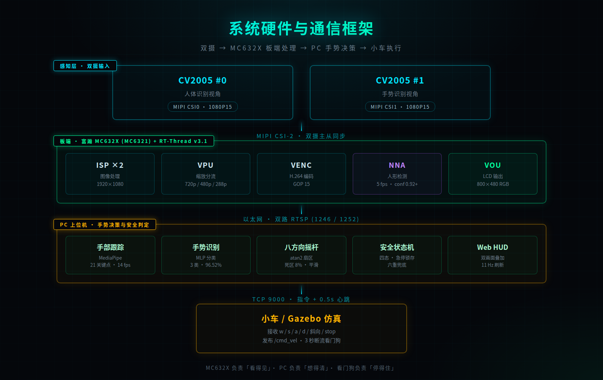

# 项目概述

在医疗诊室、食品加工车间、洁净实验室这些场景中，相信大家都遇到过既希望远距离操作设备，又不愿意让手接触公共操控面板的情况。实体摇杆用久了会磨损漂移，手机 App 又只是把塑料面板换成了玻璃屏幕，接触传播的问题原封不动。围绕这些需求，我使用富瀚 MC632X 平台与 RT-Thread，开发了一套双摄像头非接触式安全虚拟摇杆系统。

系统接入两颗 CV2005 摄像头，由板端完成视频采集、图像处理、H.264 编码和人形检测，再通过以太网把视频与检测结果传输给 PC。PC 端在两路实时画面上分别做手部跟踪与人形框叠加，提供手部 21 关键点提取、手势识别、八方向摇杆映射、零点校准与四态安全状态机，并把摇杆输出经 TCP 心跳下发为小车控制指令；张开手掌即触发急停，手离开画面自动回中，网络断流由对端看门狗兜底。



项目的开发从「单摄画面能够正常推流」开始，逐步扩展到「双路网络视频、板端人形检测和手势摇杆控制」。在这个过程中，重点解决了双摄主从同步、屏驱动匹配、模型内存归属和多路帧率分配等问题。

## 完整工作闭环

```
操作者进入摄像头视野
    ↓
板端 NPU 确认「有人在操作」，5 fps，置信度 0.92+
    ↓
手势摄像头捕获手部 21 关键点，14 fps
    ↓
判断手势：张开手掌？
    ├─ 是 → 急停（锁存），下发 stop
    └─ 否 → 掌心位置映射为八方向 + 幅度
              ↓
         四态状态机判定（待机 / 就绪 / 运行 / 急停）
              ↓
         TCP 9000 下发指令，0.5 秒心跳
              ↓
         小车执行 /cmd_vel
```

三种异常路径均能自动收敛到停车：手离开画面时偏移量平滑衰减至 0；张开手掌立即 stop 并锁存；网络断流 3 秒由对端看门狗刹车。

## 与传统方案的三个本质区别

这套系统不是把手势识别包装成一个摇杆，而是在三个层面改变了控制范式。

手不碰任何东西。实体摇杆要手指压杆，手机 App 虚拟摇杆要手指触屏，两者都存在接触面。手机 App 只是把塑料摇杆换成了玻璃屏幕，接触传播的问题没有任何改变。本系统彻底取消接触面，操作者与设备之间没有物理媒介。

安全是分级的。普通手势遥控里，「手在动」和「想让它动」是同一件事——手一挥车就走，误触发无法避免。本系统把「手在画面里」和「允许运动」分开：只有掌心进入工作区、偏移超过死区、且当前不是急停手势时，才输出方向指令，任何一层不满足就停止。

双摄异构分工。单摄系统无法回答「操作者是否还在看这个画面」。本系统用板端 NPU 独立确认人形存在（不依赖 PC），用第二路摄像头做手势跟踪，两条链路物理隔离——PC 侧崩溃不影响板端的人形确认。

## 分工设计的由来

板端 NPU 在 1080P 输入下只有 5 fps 的推理能力，跑不动 MediaPipe 的 21 点手部模型（需要 10 fps 以上才有跟随感）。但板端的优势是不依赖 PC——即使 PC 掉线，板端仍在检测画面里有没有人。

因此人形检测留在板端求稳，手部跟踪放到 PC 求快，两路并行互不抢占。这不是妥协，而是把两颗芯片各自的长处都榨出来。

## 实测数据

| 指标 | 实测值 |
|---|---|
| 双摄分辨率 | 1280×720 × 2 |
| 板端人形检测 | 5.0 fps，置信度 0.92~0.98 |
| PC 手部检测 | 12~14 fps |
| 视频采集 | 55 fps（改造前 10.5 fps）|
| 手势分类准确率 | 96.52%（4450 条真实样本）|
| 控制指令频率 | 20 Hz |
| 端到端延迟 | 40~80 ms |
| 固件体积 | 4.1 MB |

## 应用价值

| 场景 | 痛点 | 本方案价值 |
|---|---|---|
| 医疗设备操作 | 术者不能触碰非无菌表面 | 零接触控制，无需额外消毒 |
| 食品/药品洁净车间 | 手套操作触屏不灵敏 | 隔空操作，不受手套影响 |
| 康复训练 | 患者手部力量不足，握不住摇杆 | 大动作即可控制，降低操作门槛 |
| 危险环境遥控 | 操作者需远距离作业 | 摄像头可延伸，人不必靠近 |

成本上，深度相机手势方案通常需要 2000 到 8000 元，本方案用已量产的 AI 视觉 SoC 加两颗普通 MIPI 摄像头，实现接近的交互能力。

## 已知限制

| 限制 | 现状 | 已排除的因素 |
|---|---|---|
| 视频源 6.55 fps | 配置 1080P15，VPU 实际输出 6.55 fps | 算力（avgtime=0）、丢帧（drop=0）、溢出（OVERFLOW=0）、分辨率（720P 报 -3003）、帧率配置（15→30 配置生效但输出不变）|
| LCD 不显示 | 驱动识别正确、时序正确、通道使能、帧计数零丢帧，但面板不出图 | 驱动选择、配置项、时序参数、VOU 通道、YCMEAN 占帧；判定为排线/面板数据线硬件问题 |
| 手势 3 类 | 张开手掌 / 握拳 / 指向前 | 使用开源预训练模型，未针对本场景重训 |
| 仅仿真验证 | Gazebo 差速小车 | 未在真实小车上测试 |

这些限制都如实记录，未做任何掩盖，也是下一阶段要继续推进的方向。
