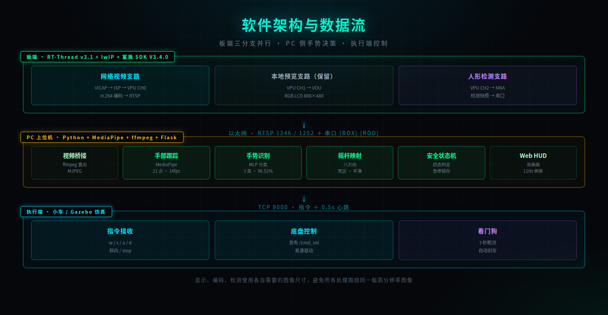

# 硬件框架

## 一、硬件组成

| 硬件组成 | 配置与作用 |
|---|---|
| 主控平台 | 富瀚 MC632X（MC6321），承担双路 ISP 处理、VPU 分流、H.264 编码、板端 NPU 人形检测与应用运行 |
| 摄像头 | 两颗 CV2005，通过 MIPI CSI0 / CSI1 接入，需开启主从同步模式 |
| 显示屏 | AT070TN94，800×480 RGB 并口，经 VOU 通道输出；本次展示不依赖该屏 |
| 网络接口 | 以太网，向 PC 传输两路 RTSP 视频流与串口检测数据 |
| 调试接口 | 串口 115200 8N1（CH340），用于 U-Boot、RT-Thread MSH 和运行日志 |
| PC | 运行 Python 服务、MediaPipe、ffmpeg 与浏览器，完成手势识别、摇杆映射与安全判定 |

两颗摄像头与网口连接在同一板端平台上，PC 通过以太网接收两路视频并拉取串口检测结果。硬件连接关系见系统框架图。

双摄分工：摄像头 G0 朝人，供板端 NPU 做人形检测；摄像头 G1 朝操作区，供 PC 做手部跟踪。两路物理隔离，PC 侧异常不影响板端的人形确认。

开发阶段使用 TFTP 将测试固件加载到 RAM，便于更换固件、对照测试和回退。板端每次重启后 IP 会恢复为 0.0.0.0，需通过串口重新配置；LCD 驱动链路已打通，但面板数据线存在硬件问题，本次展示不依赖该屏，分析结果统一在 PC 端呈现。

## 二、主控芯片

| 项 | 规格 |
|---|---|
| 型号 | 富瀚 MC632X / MC6321 |
| 平台 ID | 0x20122801 |
| 内核 | ARM Cortex-A7 |
| 专用加速单元 | ISP 两路、VPU、VENC、NNA（NPU）、VOU |
| 内存 | 64 MB DDR3 |
| SDK 版本 | 富瀚 V3.4.0 |
| 工具链 | arm-fullhanv2-eabi-b3（GCC 6.3.1）|

内存布局：

| 区域 | 大小 | 用途 |
|---|---|---|
| 0x40000000 ~ 0x41800000 | 24 MB | RT-Thread 内核与应用堆 |
| 0x41800000 ~ 0x43F80000 | 42 MB | 富瀚 SDK（VPU / VENC / NNA 缓冲）|

## 三、摄像头

| 项 | 值 |
|---|---|
| 型号 | CV2005，两路同型号 |
| 接口 | MIPI CSI-2，2 lane |
| I2C 地址 | 0x6c（7bit 0x36）|
| 时钟 | 24 MHz |
| 支持格式 | 仅 1080P15 / 1080P30 |

驱动库里只有四种 1080P 配置，没有 720P。实测尝试 720P25 时，set sensor format 返回 -8002，ISP 初始化报 -3003，demo 直接退出。这是 CV2005 驱动层面的限制。

双摄硬件要求：两路 MIPI 接口（CSI0 / CSI1）、两路 sensor 控制信号（SENSOR_RSTN0/1、SENSOR_CLK0/1），并且必须开启 CONFIG_SENSOR_SLAVE_MODE 做主从同步，否则 MIPI 时序无法对齐。

## 四、显示屏

| 项 | 值 |
|---|---|
| 型号 | AT070TN94 |
| 类型 | RGB 并口 TFT |
| 分辨率 | 800 × 480 |
| 刷新率 | 60 Hz |

时序参数：水平方向 Sync 1 / Back Porch 45 / Active 800 / Front Porch 210，垂直方向 Sync 1 / Back Porch 22 / Active 480 / Front Porch 22。像素时钟 PLL sel=2，div=17，输出 60 Hz。

## 五、调试与网络接口

| 接口 | 用途 | 参数 |
|---|---|---|
| UART0 | 调试串口（MSH）| 115200 8N1，CH340（1a86:7523）|
| 以太网 | 视频流与控制 | 板 192.168.215.201，PC 192.168.215.50 |
| TFTP | 固件烧录 | tftp 40000000 media_demo.bin |

烧录流程：

```
1. 板子复位，等 Hit any key 提示，快速连按空格进入 U-Boot
2. tftp 40000000 media_demo.bin     # 加载固件，约 4.1 MB
3. go 40000000                       # 跳转执行
4. ifconfig e0 192.168.215.201 netmask 255.255.255.0    # 配置网络
5. vlcview -p 1240                   # 启动视频应用
```

板子每次重启后 IP 都是 0.0.0.0，必须重新配置，RT-Thread 默认不启用 DHCP。

## 六、硬件已知问题

| 问题 | 现象 | 状态 |
|---|---|---|
| LCD 数据线 | 只能显示黑白，RGB 颜色不显示 | 软件侧已穷尽排查，判定物理层 |
| CV2005 帧率 | 配置 15 fps，实际输出 6.55 fps | Sensor 与 MIPI 时序限制 |
| CV2005 分辨率 | 不支持 720P | 驱动库只含 1080P 配置 |

# 软件框架

## 一、RT-Thread 与板端任务组织

RT-Thread 为应用提供线程调度、同步、内存管理和设备访问能力，lwIP 提供网络通信支持，MSH 用于启动应用及读取媒体模块状态。

板端在同一个 VPU 上分出三条支路并行工作，各自使用需要的图像尺寸：

| 支路 | 数据路径 | 作用 |
|---|---|---|
| 网络视频 | 摄像头 → VICAP → ISP → VPU CH0 → H.264 编码 → RTSP | 向 PC 提供两路实时视频 |
| 本地预览（保留路径）| VPU CH1 → VOU → RGB LCD | 本次展示不依赖此路径 |
| 人形检测 | VPU CH2 → NNA → 检测快照 → 串口 | 输出人形框坐标与置信度 |

这样的组织方式使显示、编码和检测可以使用各自需要的图像尺寸，避免所有处理都围绕同一幅高分辨率图像进行。

软件架构与数据流见下图：



## 二、板端关键配置

| 配置项 | 值 | 作用 |
|---|---|---|
| VIDEO_GRP0 / VIDEO_GRP1 | y | 启用两组视频处理 |
| CONFIG_SENSOR_SLAVE_MODE | y | 双摄主从同步 |
| FH_USING_CV2005_MIPI_G0/G1 | y | 两路都用 CV2005 |
| FH_APP_USING_FORMAT_1080P15_G0/G1 | y | Sensor 输出格式 |
| CH0_ENABLE_G0/G1 | y | 两路编码通道 |
| CH1_ENABLE_G0 | y | 屏显通道 |
| FH_APP_USING_RTSP_G0/G1 | y | 两路 RTSP 服务 |
| DEVICE_DHD0 | y | 显示设备 |
| YCMEAN_EN_G0 | 未设置 | 关闭 loop buffer，屏显必需 |
| FH_APP_OPEN_OVERLAY | 未设置 | 关闭 OSD，失败会中止 demo |

## 三、PC 端任务组织

PC 端围绕两路视频各建一条处理链，互不抢占：

| 模块 | 职责 | 频率 |
|---|---|---|
| 视频桥接 | 两条 ffmpeg 管线把 RTSP 直转为 MJPEG，Python 只切帧不重编 | ~55 fps |
| 手部跟踪 | MediaPipe 提取 21 个关键点，输入 480×270 | 12~14 fps |
| 手势识别 | MLP 分类张开手掌 / 握拳 / 指向前 | 随手部跟踪 |
| 摇杆映射 | 掌心相对零点计算偏移，按 45° 切分八方向 | 随手部跟踪 |
| 安全状态机 | 四态判定，急停锁存 | 随手部跟踪 |
| Web 服务 | Flask 提供页面、MJPEG 接口与状态 API | 11 Hz 轮询 |

视频与手部检测使用两条独立的 ffmpeg 进程。视频走全分辨率 MJPEG 直出，手部走低分辨率 rawvideo，两者互不拖累。

## 四、线程与进程划分

| 执行体 | 类型 | 职责 |
|---|---|---|
| video_loop(0) | 线程 | 摄像头 G0 拉流 → MJPEG 队列 |
| video_loop(1) | 线程 | 摄像头 G1 拉流 → MJPEG 队列 |
| hand_frame_loop | 线程 | 摄像头 G1 → 480×270 rawvideo |
| hand_loop | 线程 | MediaPipe 推理与摇杆更新 |
| board_loop | 线程 | 串口读人形检测数据 |
| Flask | 线程池 | HTTP API 与 MJPEG 推流 |
| ffmpeg 三路 | 进程 | 两路视频加一路手部帧 |

## 五、控制协议

主通道为 TCP，Linux 作服务端，执行端主动连接 9000 端口，协议为纯文本行。指令只在方向变化时更新，每 0.5 秒心跳重发当前指令，保证执行端 3 秒断流看门狗不会误触，同时在上位机真正崩溃时能正常刹车。

| 指令 | 动作 | 摇杆方向 | 角度区间 |
|---|---|---|---|
| w | 前进 | FWD | 337.5°~22.5° |
| wr | 右前 | FWD_RIGHT | 22.5°~67.5° |
| d | 右转 | RIGHT | 67.5°~112.5° |
| sr | 右后 | BACK_RIGHT | 112.5°~157.5° |
| s | 后退 | BACK | 157.5°~202.5° |
| sl | 左后 | BACK_LEFT | 202.5°~247.5° |
| a | 左转 | LEFT | 247.5°~292.5° |
| wl | 左前 | FWD_LEFT | 292.5°~337.5° |
| stop | 停止 | 死区内 / 急停 | — |

备用通道为 UDP 广播，20 Hz，JSON 格式，单包约 110 字节，实测 5 秒收到 100 个包。

## 六、状态机设计

摇杆四态状态机：

```
        无手 / 不在工作区
     ┌──────────────────────┐
     ↓                      │
  待机 ──手进入──→ 就绪 ─────┘ 手离开
                    │
                    │ 偏移超过死区
                    ↓
                  运行
                    │
                    │ 张开手掌
                    ↓
              急停（锁存）
                    │
                    │ 手离开工作区
                    ↓
                  待机
```

校准状态机：空闲状态点击校准进入收集态，连续握拳满 3 次后计算零点并结束，未满 3 次时显示当前进度。

## 七、关键技术决策

| 决策 | 选择 | 理由 | 放弃的方案 |
|---|---|---|---|
| 手部检测位置 | PC | 板端 NPU 5 fps 跑不动 21 点模型 | 板端运行，帧率不可接受 |
| 人形检测位置 | 板端 NPU | 保底安全，独立于 PC | 全放 PC，失去板端独立性 |
| 手势分类 | 预训练 MLP | 手写规则会把半张手误判成握拳 | 手写角度规则 |
| 视频传输 | ffmpeg 直出 MJPEG | 避免 Python 编解码与 GIL 阻塞 | Python 解码再编码，仅 10.5 fps |
| 控制通道 | TCP 加 0.5 秒心跳 | 不误触看门狗，真断线能刹车 | 只在变化时发送 |
| 模型加载 | 内联进 .data 段 | 不依赖文件系统 | 存到 Flash 分区 |
| 串口设备 | glob 自动探测 | USB 口变化导致编号漂移 | 硬编码 ttyUSB0 |
| 画面方向 | 左右镜像 | 像照镜子，符合直觉 | 原始方向 |

## 八、目录结构

板端：

```
media_demo/
├── .config                                    menuconfig 配置
├── config.h                                   生成的 C 头文件
├── sample_common/MC632X/dsp/
│   ├── enc/src/enc_config.c                   编码配置
│   ├── nna/src/nna_config.c                   模型加载
│   ├── vpu/src/vpu_bind_info.c                VPU 通道绑定
│   └── vou/src/vou_config.c                   VOU 显示配置
├── sample_demo/
│   ├── sample_common_demo.c                   OSD 条件编译
│   └── nna_app/src/
│       ├── sample_nna_obj_detect.c            主逻辑
│       └── persondet.nbg                      人形模型，2.0 MB
├── script/
│   ├── Sensor0_Kconfig                        G0 sensor 配置
│   └── Sensor1_Kconfig                        G1 sensor 配置
└── out/bin/media_demo.bin                     固件产物
```

PC 端：

```
host/
├── web_host.py           主程序
├── joystick.py           摇杆映射
├── gesture_mlp.py        手势分类
├── car_link.py           摇杆到车辆指令
├── tcp_ctrl_hb.py        TCP 服务端
├── vehicle_udp.py        UDP 广播
├── carctl.py             调试控制台
├── models/
│   ├── keypoint_classifier.tflite     MLP 模型，6.1 KB
│   └── keypoint_classifier_label.csv
├── web/
│   └── index.html        Web 界面
└── windows/
    └── car_receiver.py   仿真机端示例
```
